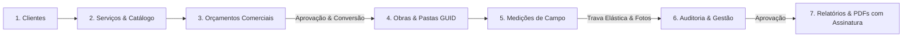

# MediPro — Sistema de Medições, Orçamentos & Gestão de Obras


O **MediPro** é uma plataforma SaaS progressiva desenvolvida para atender às demandas de **marmorarias, instaladores de pedras nobres, construtoras, empreiteiras de acabamento fino e profissionais autônomos**. 

A ferramenta digitaliza e conecta todo o fluxo produtivo: desde a captação e cadastro de **Clientes**, montagem do **Catálogo Unificado**, emissão de **Orçamentos Comerciais** com papel timbrado e assinatura digital, conversão automática em **Projetos/Obras** organizados em pastas (com rotas GUID), até o apontamento de **Medições de Campo** com **Trava Elástica**, auditoria de excedentes, rateio de despesas operacionais e exportações em **PDF e planilhas**.

---

## 🧭 Fluxo Operacional de Ponta a Ponta



---

## ✨ Principais Funcionalidades e Módulos

### 1. Início & Pulso Diário (`/`)
- **Pulso Diário (Últimas 24h)**: Cards estatísticos rápidos exibindo volume total medido em R$, volume aprovado em R$, total de medições e itens que requerem auditoria.
- **Timeline 24h de Atividades**: Feed em tempo real de eventos da equipe (`Medição Criada`, `Medição Aprovada`, `Entrada/Saída de Colaboradores`, `Revisão Solicitada`) com abas de filtragem e marcação de status lido/não lido.
- **Acessos Recentes**: Carrossel horizontal de acesso em 1 clique com os últimos projetos e medições visitados pelo usuário logado.
- **Atalhos Rápidos**: Botões diretos para ações frequentes de acordo com a função do usuário (Nova Medição, Novo Orçamento, Nova Obra, Cadastrar Cliente).

---

### 2. Gestão de Clientes & CRM Leve (`/clientes`)
- **Segmentação por Perfil**: Classificação por categorias com identificação visual:
  - 🏠 *Residencial* (Clientes finais)
  - 🏢 *Construtora / Obra* (Construtoras e empreiteiras)
  - 📐 *Arquiteto / Parceiro* (Especificadores e parceiros comerciais)
- **Visualização Flexível**: Alternância dinâmica entre visualização em **Cards (Grid)** e **Tabela** analítica.
- **Métricas de Topo**: Consolidação automática de total de clientes, faturamento acumulado e clientes com obras ativas no mês.
- **Gaveta de Histórico do Cliente (`ClientHistoryDrawer`)**: Gaveta lateral deslizante que reúne o histórico consolidado de medições, obras ativas e propostas vinculadas àquele cliente.
- **Modal de Cadastro/Edição (`ClientFormModal`)**: Validação de dados de contato, WhatsApp para disparo rápido, CPF/CNPJ e endereço de obra.

---

### 3. Catálogo Unificado de Composições (`/servicos` e `/configuracoes`)
Elimina duplicidades cadastrais ao unificar serviços e insumos em 3 naturezas essenciais:
1. **Mão de Obra (`labor`)**: Corte, assentamento, polimento, acabamento 45° e furações.
2. **Material / Insumo (`material`)**: Argamassas AC3, massas plásticas, selantes PU, cubas e insumos de fixação.
3. **Ajudante / Terceiro (`subcontract`)**: Diárias de auxiliares, fretes, içamentos de lastras e carretos.

- **Unidades de Medida Padronizadas**: Suporte nativo a `m²`, `m linear`, `cm`, `unidade`, `diária`, `kg` e `saco`.
- **Visão Corporativa vs. Autônomo**:
  - *Modo Empresa*: O gestor gerencia o Catálogo Mestre corporativo com preços sugeridos e regras de remuneração da equipe.
  - *Modo Autônomo (`SOLO`)*: Catálogo pessoal com controle direto de preços de venda e serviços avulsos.
- **Modal Ergonômico de Serviço (`ServiceFormModal`)**: Scroll interno próprio (sem estourar a janela do navegador), seletor de natureza em cards, categoria, unidade, preço e tags de complexidade.
- **Assistente de Precificação (`ServicePricingWizardModal`)**: Wizard integrado para composição e sugestão de preços base.

---

### 4. Orçamentos Comerciais & Papel Timbrado (`/orcamentos`)
- **Relação 1 Projeto : N Orçamentos**:
  - **Orçamento Base**: Proposta comercial principal da obra.
  - **Orçamentos Aditivos**: Aditivos complementares vinculados diretamente ao projeto existente.
- **Agrupamento Estilo Outlook**: Listagem inteligente separada por seções temporais (*Hoje*, *Ontem*, *Últimos 7 dias*, *Mês de [Nome]* e *Anteriores*).
- **Formulário de Orçamento (`BudgetFormPage`)**:
  - `CatalogServicePickerModal`: Modal de altura fixa com abas segmentadas (*Mão de Obra*, *Materiais*, *Terceiros*), busca em tempo real e seleção de itens em 1 clique.
  - Inclusão ágil de itens manuais avulsos com `<Select>` padronizado de unidades de medida.
  - Cards de composição em duas zonas (Zona 1: Local/Ambiente e Descrição; Zona 2: Qtd, Unidade, Preço Unitário e Subtotal).
  - `SummaryFooter`: Barra fixa no rodapé detalhando totais por natureza (`labor`, `material`, `subcontract`), investimento total e atalhos de envio/salvamento.
  - **Vinculação Automática de Assinatura**: Captura e anexa automaticamente a assinatura digital do emissor logado.
- **Visualização da Proposta & Impressão A4 (`BudgetDetailPage`)**:
  - **Papel Timbrado Comercial**: Aplicação automática de logotipo, dados da empresa/autônomo, cores da marca e condições contratuais.
  - **Conversão em Obra em 1 Clique**: Ação no menu dropdown que converte um orçamento aprovado em uma obra ativa, migrando todos os itens aprovados para o **Escopo Contratado** do projeto.
  - **Assinatura Digital**: Exibição da assinatura PNG/SVG e do nome do responsável técnico acima da linha de validação.
  - **Rota Pública para Cliente (`/#/proposta/:id`)**: Link externo formatado para visualização no celular do cliente via WhatsApp, sem exigir login.
  - Impressão formatada em folha A4 (`@media print`) pronta para assinatura física ou PDF formal.

---

### 5. Projetos, Pastas (GUID) & Obras (`/projetos`)
- **Organização por Pastas com Rota GUID**:
  - Criação de pastas com identificador imutável GUID (ex: `/projetos/pasta/a1b2c3d4-e5f6-...`).
  - Navegação fluida com breadcrumbs estruturados (`Projetos > Pasta > Obra`).
  - Título e cor da pasta destacados no topo da tela, mantendo a visualização contextualizada.
- **Controle de Escopo Contratado vs. Executado (`ProjectScopeTrackingCard`)**:
  - Tabela com todos os itens do contrato (base + aditivos aprovados).
  - Acompanhamento em tempo real de: Quantidade Prevista, Quantidade Executada por Medições e Saldo Restante.
  - Aditivos aprovados incorporam novas linhas de escopo rastreáveis, sem sobrescrever o contrato inicial.
- **Navegação Interna em Abas**:
  - 📊 *Dashboard*: Progresso físico-financeiro (% concluído vs. teto orçado).
  - 📐 *Escopo*: Tabela de quantidades contratadas e saldo remanescente.
  - 📋 *Medições*: Histórico de apontamentos com botão "Voltar" inteligente contextual para a pasta da obra.
  - 💼 *Orçamentos*: Propostas base e aditivos vinculados.
  - 👥 *Equipe da Obra*: Alocação de encarregados e instaladores via `AddProjectMemberModal`, com trava de limite de vagas da obra.

---

### 6. Medições de Campo & Trava Elástica (`/medicoes`)
- **Apontamento em Campo (`NewMeasurementPage`)**:
  - Seleção contextual de obra e cliente (ou cliente direto para autônomos).
  - Adição rápida de itens do escopo da obra ou itens do catálogo.
  - **Trava Elástica (`ElasticGuardAlert`)**: Sistema em tempo real que compara a metragem informada com o saldo disponível do escopo contratado. Caso exceda o limite:
    - O sistema sinaliza visualmente o excesso.
    - Exige preenchimento de **Motivo do Excesso** (*Aditivo solicitado pelo cliente*, *Retrabalho de terceiros*, *Diferença de medida em obra*, etc.).
    - Exige **Justificativa Textual** e envio obrigatório de **Foto de Evidência da Obra**.
  - **Serviços Extras / Fora de Escopo (`OutOfScopeServiceCard`)**: Lançamento de trabalhos não orçados com exigência de justificativa e foto de evidência.
  - **Despesas Operacionais de Campo (`OperationalCostsCard`)**: Lançamento discriminado de despesas de transporte, hospedagem, alimentação e risco/setup.
  - `SummaryFooter`: Divisão em tempo real do valor que está no escopo vs. valor sujeito a auditoria.
- **Visualização Técnica da Medição (`MeasurementDetailPage`)**:
  - Apresentação completa com dados de localização, instalador responsável, tabela detalhada e custos de campo.
  - Lightbox modal (`Dialog`) para ampliação de fotos de evidência em alta resolução.
  - Bloco de **Assinaturas e Validação**: renderização da imagem da assinatura digital do executor, nome obrigatório e campo de conferência da fiscalização.
  - Modal de compartilhamento WhatsApp (`ShareLinkModal`).

---

### 7. Dashboard de Auditoria & Gestão de Medições (`/dashboard`)
Central de controle para perfis de gestão (`MANAGER`, `PROJECT_SUPERVISOR`, `MASTER`):
- **Painel Financeiro em Tempo Real**: Total pendente de liberação, total aprovado, medições em conferência e membros em campo.
- **Inspeção Detalhada em Acordeão (`MeasurementReviewRow` / `MeasurementDetailView`)**: Abertura inline dos itens da medição, análise de fotos anexadas e justificativas de excesso.
- **Auditoria Granular Item a Item**: O gestor pode aprovar ou rejeitar individualmente o excedente ou item extra sem travar o restante da medição.
- **Aprovação em Lote (`BulkApprovalBar`)**: Seleção múltipla de medições para aprovação em massa.
- **Devolução para Ajuste (`RequestReworkModal`)**: Retorno da medição para o instalador com notas obrigatórias sobre o que deve ser corrigido.

---

### 8. Gestão de Equipe & Controle de Licenças (`/equipe`)
- **Controle de Licenças (`TeamUsageBanner`)**: Acompanhamento de vagas ocupadas vs. contratadas no plano do tenant.
- **Gestão de Instaladores**: Tabela completa com cargo/especialidade, contato, status do convite (*Ativo*, *Pendente*, *Inativo*), valor de diária base e métricas mensais.
- **Modais**:
  - `InviteMemberModal`: Convite de novos membros por WhatsApp/E-mail com função e remuneração base.
  - `LimitReachedDialog`: Alerta inteligente de cota de licenças excedida com direcionamento para upgrade.
  - Ação de suspender e reativar colaboradores liberando licenças ativas imediatamente.

---

### 9. Assinatura Digital & Identidade Visual (`/perfil`)
- **Assinatura Digital (Disponível para Todos os Perfis)**:
  - Upload de arquivos de assinatura nos formatos **PNG** ou **SVG** (suporte a transparência).
  - Visualização em canvas com remoção em 1 clique.
  - **Nome na Assinatura Obrigatório**: Exigência de preenchimento do nome que acompanhará a assinatura (ex: *Eng. Carlos Mendes — CREA 12345* ou *Lucas Ferraz — Instalador*).
  - Vinculação automática em qualquer novo orçamento ou medição emitidos pelo usuário.
- **Identidade Comercial / Papel Timbrado (`BrandIdentityFormTab`)**:
  - Customização de Logotipo corporativo, Nome Fantasia, Razão Social, CNPJ/CPF, Telefone e Endereço.
  - Paleta de cores da marca (presets e cores personalizadas).
  - Pré-configuração das cláusulas contratuais e termos de garantia padrão para propostas comerciais.

---

## 📄 O Que o MediPro é Capaz de Gerar (Outputs)

| Tipo de Saída | Formato | Descrição |
| :--- | :--- | :--- |
| **Proposta Comercial Timbrada** | A4 / Web / PDF | Proposta comercial completa com identidade da marca, breakdown por natureza, termos comerciais e bloco duplo de assinaturas. |
| **Relatório Operacional de Medição** | PDF Formal | Documento técnico emitido via `exportMeasurementToPDF` contendo serviços, despesas operacionais e assinatura digital do executor. |
| **Relatório Consolidado de Medições** | PDF | Fechamento consolidado de múltiplas medições de uma obra para faturamento junto a construtoras (`exportMultipleMeasurementsToPDF`). |
| **Planilha de Dados Operacionais** | CSV | Exportação tabular para conciliação contábil e importação em ERPs (`exportMeasurementsToCSV`). |
| **Link Público Interativo** | Web / WhatsApp | Links com tokens seguros (`/#/proposta/:id` e `/#/medicoes/:id`) para abertura direta no smartphone do cliente. |

---

## 🛠️ Stack Tecnológica & Padrões de Projeto

- **Frontend Core**: [React 19](https://react.dev/), [TypeScript 5.7](https://www.typescriptlang.org/), [Vite 6](https://vitejs.dev/)
- **Roteamento**: [React Router v7](https://reactrouter.com/) (com `HashRouter` para compatibilidade total de deploy estático/SPA)
- **Estilização & UI**: [Tailwind CSS 3.4](https://tailwindcss.com/), `tailwindcss-animate`, [Radix UI Primitives](https://www.radix-ui.com/), [Lucide React Icons](https://lucide.dev/)
- **Design System**: 100% aderente aos padrões do **Shadcn UI** (eliminação completa de tags nativas de formulário fora de `@/components/ui/`)
- **Gerenciamento de Estado**: [Zustand 5](https://github.com/pmndrs/zustand) com middleware `persist` em `localStorage` devidamente versionado e isolado por tenant/usuário
- **Datas & Formatações**: `date-fns 4` e utilitários puros de cálculo financeiro e temporal

---

## 🚀 Como Executar o Projeto Localmente

### Pré-requisitos
- [Node.js](https://nodejs.org/) versão 18 ou superior
- Gerenciador de pacotes `npm` ou `pnpm`

### Instalação e Execução

1. **Clone o repositório:**
   ```bash
   git clone https://github.com/seu-usuario/medipro.git
   cd medipro
   ```

2. **Instale as dependências:**
   ```bash
   npm install
   ```

3. **Inicie o servidor de desenvolvimento:**
   ```bash
   npm run dev
   ```
   Acesse a aplicação no navegador em: `http://localhost:5173`

4. **Executar verificação de tipos e build de produção:**
   ```bash
   npm run build
   ```
   *Gera a pasta otimizada `dist/` com verificação estrita do TypeScript (`tsc -b && vite build`).*

---

## 👥 Perfis Disponíveis para Demonstração (Login Mock)

Na tela de login (`/login`), é possível alternar instantaneamente entre os perfis de demonstração:
- 👑 **Patrão / Dono (`MANAGER`)**: Carlos Mendes (acesso total à empresa, timbrado e aprovação de medições).
- 👷 **Encarregado de Obra (`PROJECT_SUPERVISOR`)**: Marcos Oliveira (gestão de obras e fiscalização de campo).
- 🔨 **Instalador de Campo (`MEMBER`)**: Lucas Ferraz (apontamento ágil de medições nas obras alocadas).
- 🚀 **Profissional Autônomo (`SOLO`)**: João Autônomo (fluxo enxuto sem equipe, com proposta própria e medição direta).

---

## 📂 Estrutura de Pastas do Repositório

```
medipro/
├── src/
│   ├── components/
│   │   ├── shared/         # Componentes transversais (PageContainer, Breadcrumbs, Modais genéricos)
│   │   └── ui/             # Design System Shadcn UI (Button, Input, Select, Dialog, Card, etc.)
│   ├── hooks/              # Custom hooks (useSmartBack, useMediaQuery, etc.)
│   ├── pages/              # Módulos e telas da aplicação
│   │   ├── auth/           # Login e autenticação
│   │   ├── budgets/        # Orçamentos comerciais e proposta timbrada
│   │   ├── clients/        # Gestão e histórico de clientes
│   │   ├── dashboard/      # Auditoria e aprovação em lote de medições
│   │   ├── home/           # Início, pulso 24h e acessos recentes
│   │   ├── measurements/   # Apontamentos de medição, trava elástica e relatórios
│   │   ├── plan/           # Informações do plano de assinatura
│   │   ├── profile/        # Minha conta, assinatura digital e branding
│   │   ├── projects/       # Obras, pastas GUID, escopo e equipe
│   │   ├── services/       # Catálogo de serviços e composições
│   │   ├── settings/       # Catálogo mestre corporativo
│   │   └── team/           # Gestão de equipe e controle de licenças
│   ├── stores/             # Estado global reativo com Zustand (persist)
│   ├── types/              # Definições estritas de TypeScript (zero any)
│   └── utils/              # Funções puras de cálculo, agrupamento Outlook e exportações
├── package.json
└── vite.config.ts
```

---

## 📄 Licença

Este projeto é desenvolvido para a versão comercial **v1.0 Release** do **MediPro**. Todos os direitos reservados.
